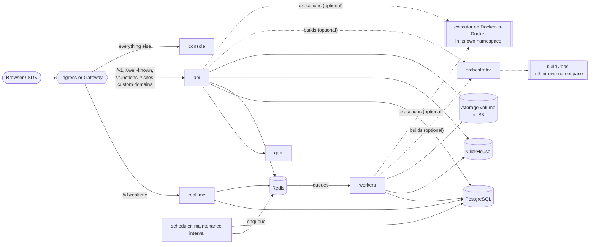

# Architecture

This page explains what the chart deploys, how the pieces talk to each other,
and which Appwrite settings the chart wires up for you.

## Components



| Component | Image | Command | Port | Scales | Notes |
| --- | --- | --- | --- | --- | --- |
| `api` | `appwrite/appwrite` | `php app/http.php` | 8080 | Horizontally (HPA) | REST and GraphQL API. Also proxies function, site and custom-domain traffic, and serves ACME challenges. |
| `console` | `appwrite/new` | image default | 3000 | Horizontally (HPA) | The web console, a separate Bun app. |
| `realtime` | `appwrite/appwrite` | `php app/realtime.php` | 8080 | Horizontally (HPA) | WebSocket server for `/v1/realtime`. One Swoole worker process per pod by default (`realtime.processes`). |
| `worker` | `appwrite/appwrite` | `php app/worker.php all` | none | See [worker topologies](#worker-topologies) | Consumes every queue: database changes, deletes, mails, webhooks, certificates, usage, builds and more. |
| `scheduler` | `appwrite/appwrite` | `php app/cli.php schedule` | none | **One replica** | Enqueues scheduled function executions and messages, and counts project resources. |
| `maintenance` | `appwrite/appwrite` | `php app/cli.php maintenance` | none | **One replica** | Periodic cleanup and certificate renewals. |
| `interval` | `appwrite/appwrite` | `php app/cli.php interval` | none | **One replica** | Verifies custom domains and queues their certificates. |
| `geo` | `appwrite/geo` | image default | 80 | `geo.replicaCount` | IP geolocation for sessions and logs. |
| `postgresql` | `appwrite/postgres` | `postgres` | 5432 | One replica | Built-in database. Optional. |
| `redis` | `redis` | `redis-server` | 6379 | One replica | Cache, queues, pub/sub and locks. Optional. |
| `clickhouse` | `clickhouse/clickhouse-server` | image default | 8123, 9000 | One replica | Usage statistics and execution logs. Optional. |
| `orchestrator` | `open-runtimes/orchestrator/jobs-service` | image default | 8080 | One replica | Runs builds of functions and sites as Jobs in the build namespace. With `compute.enabled`. |
| `executor` | `openruntimes/executor`, run by `docker:dind` | see [executor.md](executor.md#the-executor) | 9900 | `compute.executor.replicaCount` | Runs functions and sites in runtime containers of its own Docker daemon, in the executor namespace. With `compute.enabled`. |

Every component has a ClusterIP Service named `<fullname>-<component>`,
except workers and tasks, which nothing connects to. The API, console,
realtime and geo Services listen on port 80; the others use the container
port. The datastores also get a headless Service for their StatefulSet.
Optional components such as the browser, assistant and MQTT broker are
described in [optional-components.md](optional-components.md).

The API and the builds worker submit builds to the orchestrator, and the API
cancels them. Build Jobs report back to the API Service. The API (synchronous
executions, function and site traffic), the functions worker and the deletes
worker call the executor.

The scheduler, maintenance and interval tasks have no leader election in
Appwrite, so a second copy would do the same work twice. The chart always runs
exactly one of each and recreates (rather than rolls) them on updates.

## Worker topologies

Appwrite's work happens on 15 Redis queues. `workers.mode` decides how they're
spread over Deployments:

| Mode | Deployments | When to use |
| --- | --- | --- |
| `combined` (default) | `worker`, consuming every queue | Small installs. Uses the least memory. |
| `separate` | `worker-<queue>`, one per queue in `workers.queues` | Scale or size each queue independently. Matches Appwrite's `docker-compose.separate.yml`. |
| `grouped` | `worker-<group>`, one per entry in `workers.groups` | Isolate noisy queues (usage, builds) without running 15 pods. |

```yaml
workers:
  mode: grouped
  groups:
    core:
      queues: [databases, deletes, mails, messaging, notifications, certificates, migrations, webhooks]
    usage:
      queues: [stats-usage, stats-resources]
      replicaCount: 2
    compute:
      queues: [builds, jobs, functions, executions, screenshots]
```

The `databases` queue applies schema changes in order and must have exactly
one consumer, so whichever Deployment consumes it is capped at one replica
and one process, and never autoscaled. In `combined` mode that is the only
worker, which is why `workers.combined.replicaCount` can't exceed 1; switch to
`separate` or `grouped` to scale the rest. That Deployment is also recreated
rather than rolled on updates, so an old and a new pod never consume the
queue at the same time.

`_APP_WORKER_MAX_COROUTINES` sets the minimum size of a worker's database
pools ([database connections](#database-connections)). In a worker that
consumes a single queue, it's also the number of jobs the worker runs at once
(`databases` always runs one). A worker that consumes several queues runs each
at Appwrite's own concurrency for that queue. The chart sets it per
Deployment, as Appwrite's compose files do:

| Mode | `_APP_WORKER_MAX_COROUTINES` | Override |
| --- | --- | --- |
| `combined` | 78, the sum of every queue's concurrency | `workers.combined.maxCoroutines` |
| `separate` | the queue's own concurrency: 8 for most queues, 1 for `databases`, `mails`, `messaging`, `migrations`, `notifications` and `stats-resources` | `workers.queues.<queue>.maxCoroutines` |
| `grouped` | the sum of its queues' concurrency | `workers.groups.<group>.maxCoroutines` |

Only workers whose queues touch files mount the `/storage` volume: deletes,
builds, jobs, screenshots, certificates, messaging and migrations. That keeps
the ReadWriteOnce co-location to the pods that need it.

`tasks.scheduler.mode: separate` similarly splits the scheduler into
`scheduler-functions`, `scheduler-executions`, `scheduler-messages` and
`stats-resources`. Each still runs as a single replica.

Queues no Deployment consumes (a disabled queue in `separate` mode, or a
queue missing from every group) are listed as a warning after install or
upgrade. Their jobs pile up in Redis until something consumes them.

## Startup order

Kubernetes has no `depends_on`, so the chart uses init containers:

1. The API's `wait-for-datastores` init container waits until PostgreSQL,
   Redis and ClickHouse accept TCP connections, built-in or external.
2. On start, every API pod creates the console database, buckets and ClickHouse
   tables if they don't exist yet. This is idempotent and can take a few
   minutes on the first install, which is why the API's startup probe is generous.
3. Realtime, workers, tasks, the MQTT broker and the migration Job wait in a
   `wait-for-api` init container until the API answers on
   `/v1/health/version`. Appwrite's CLI tasks and workers exit when they start
   before the schema exists.

The other components don't wait for anything. After an upgrade to a new
Appwrite version, a Job migrates the data
([upgrading.md](upgrading.md#what-happens-during-an-upgrade)).

## Probes and disruption budgets

| Component | Probes | PodDisruptionBudget |
| --- | --- | --- |
| API | `/v1/health/version` (startup, readiness, liveness) | When more than one replica can run, unless a ReadWriteOnce volume pins it to one node |
| console, realtime | Startup, readiness, liveness | When more than one replica can run |
| geo, datastores, orchestrator, executor, optional components | Readiness and liveness, most also startup | None |
| workers, scheduler, maintenance, interval | None | None |

"More than one replica" means `replicaCount` above 1, or autoscaling with
`minReplicas` above 1. Turn a budget off with `<component>.pdb.enabled: false`.

Two consequences:

- **Workers and tasks are restarted only when their process exits.** A worker
  that hangs stays `Running` while its queue grows; watch the queues
  ([production.md](production.md#monitoring)).
- **Nothing limits how many workers, tasks or executor pods a node drain
  evicts at once.** An evicted worker gets
  `workers.terminationGracePeriodSeconds` (45) to finish its jobs. An evicted
  executor pod gives executions in flight 15 seconds, then stops with its
  warm runtimes; the next executions start cold.

`/v1/health/version` only reports Appwrite's version. It doesn't test the
datastores, so a ready API pod doesn't mean they're reachable; the
[health API](production.md#health-api) checks them.

## Configuration flow

Every pod that runs the Appwrite image gets the same configuration:

- **`<fullname>-env` ConfigMap**, loaded with `envFrom`. It starts from the
  defaults Appwrite's Docker installer writes to `.env`
  ([`files/env-defaults.yaml`](../charts/appwrite/files/env-defaults.yaml)),
  then applies values the chart computes, then `appwrite.config`.
- **`<fullname>-env` Secret** with `appwrite.secretConfig`, then whatever
  `appwrite.extraEnvFrom` lists, both loaded with `envFrom` after the
  ConfigMap.
- **Credentials**, referenced one variable at a time with `secretKeyRef`, so
  the chart works the same whether a credential comes from the chart's own
  Secret or from one you manage.
- **Per-pod variables** that depend on the component: `PORT`, `_APP_CPU_NUM`,
  `_APP_WORKERS_NUM`, `_APP_WORKER_MAX_COROUTINES` and the ClickHouse
  connection strings. Set them through the component's values (`cpuNum`,
  `processes`, `maxCoroutines`, where the component has them). Setting one in
  `appwrite.config` or `appwrite.secretConfig` replaces it in every pod.

[integrations.md](integrations.md#which-value-wins) lists which source wins
when a variable is set in more than one place.

Pods carry checksums of the ConfigMap and the chart's Secrets, so changing
values rolls them. Changes to Secrets you manage yourself don't; use a tool such as
[Reloader](https://github.com/stakater/Reloader) for that
([gitops.md](gitops.md#after-changing-a-secret)).

### Values the chart computes

| Variable | Value |
| --- | --- |
| `_APP_DOMAIN`, `_APP_CONSOLE_DOMAIN` | `appwrite.domain`, `appwrite.consoleDomain` |
| `_APP_DOMAIN_FUNCTIONS`, `_APP_DOMAIN_SITES` | `functions.<domain>`, `sites.<domain>` unless set |
| `_APP_DOMAIN_TARGET_CNAME` | `appwrite.domain` unless set |
| `_APP_DB_*` | the built-in PostgreSQL Service, or `database.external` with `database.mode: external` |
| `_APP_REDIS_*` | the built-in Redis Service, or `redis.external` with `redis.mode: external` |
| `_APP_CONNECTIONS_DB_USAGE`, `_APP_CONNECTIONS_DB_EXECUTIONS` | the built-in ClickHouse Service, or `clickhouse.external.url` with `clickhouse.mode: external` |
| `_APP_CONNECTIONS_MAX`, `_APP_POOL_CLIENTS` | `database.connectionsMax`, `database.poolClients` |
| `_APP_GEO_ENDPOINT` | the geo Service, or empty when geo is disabled |
| `_APP_MIGRATION_HOST` | the API Service's DNS name, `<fullname>-api.<namespace>.svc` |
| `_APP_WORKER_SCREENSHOTS_ROUTER`, `_APP_JOBS_ENDPOINT` | the API Service URL |
| `_APP_EXECUTOR_HOST`, `_APP_JOBS_HOST` | the executor and orchestrator Services, with `compute.enabled` |
| `_APP_CPU_NUM` | each component's CPU limit (or request), rounded up |

### Why `_APP_CPU_NUM` matters

Appwrite sizes the API's Swoole worker count and every database pool from the
CPU count. Without `_APP_CPU_NUM` it reads the node's CPUs, ignoring the
container limit, so a small pod on a 64-core node starts hundreds of workers
and opens far more database connections than intended. The chart sets it from
each component's CPU limit, or its request when there's no limit, rounded up
to a whole CPU. Override it with `cpuNum` on the API, realtime, the combined
worker, worker groups and MQTT; tasks and `separate` workers always derive it
from their resources.

### Database connections

Each Appwrite process keeps two connection pools to the main database, one
for the console's data and one for the projects' data, plus one to each of
DocumentsDB and VectorsDB when they're enabled. Every pool has the same size:

```text
pool size = max(1,
                connectionsMax / poolClients / (cpuNum × workerPerCore),
                _APP_WORKER_MAX_COROUTINES)
```

rounded down. The middle term is the pod's share of the budget.
`appwrite.workerPerCore` is 6 by default, and the chart sets
`_APP_WORKER_MAX_COROUTINES` only on workers and the scheduler (1 elsewhere).

| Component | Processes per pod | Pool size |
| --- | --- | --- |
| API | `cpuNum × workerPerCore` | from the budget |
| realtime | `realtime.processes` (1) | from the budget |
| Workers | `processes` (1) | at least `maxCoroutines` |
| scheduler | 1 | at least 8 |
| maintenance, interval | 1 | from the budget |

Pools open connections on demand, so a quiet pod holds fewer, but under load
a pod can hold processes × pools × pool size connections.

So `connectionsMax` and `poolClients` set the API's and realtime's share, while
`maxCoroutines` sets the workers'. With the defaults (`connectionsMax` 151,
`poolClients` 15, one CPU per pod) the budget gives a pool size of 1, and the
ceiling is 12 for the API, 2 for realtime, 156 for the combined worker, 16 for
the scheduler and 2 each for maintenance and interval: 190 in all. The built-in
PostgreSQL sets `max_connections` to `connectionsMax + 20` (171) unless
`database.builtin.maxConnections` says otherwise, and a worker only gets
near its ceiling when it runs dozens of jobs at once.

To size the database, add up the ceiling for every pod at peak, counting HPA
maximums, and keep it below `max_connections`. Keep `poolClients` at least the
number of Appwrite pods; the install notes warn when it isn't.
[external-databases.md](external-databases.md#connections) has the steps for
a managed database.

### Health checks without a Host lookup

Appwrite routes every request by its `Host` header and looks unknown hosts up
in the database (custom domains), redirecting to HTTPS when `forceHttps` is on.
The chart sets `_APP_MIGRATION_HOST` to the API Service's DNS name,
`<fullname>-api.<namespace>.svc`, which Appwrite treats as an internal
hostname, and its probes, init containers and tests send that `Host` header.
They then skip both the lookup and the redirect. Build pods in the build
namespace reach the API under the same name, which is why it includes the
namespace.

Appwrite skips the HTTPS redirect for this hostname, and the custom-domains
route forwards any `Host` to the API. A client outside the cluster that sends
`Host: <fullname>-api.<namespace>.svc` can therefore reach the API over plain
HTTP. It's the same API with the same authentication, but if plain HTTP must
never be accepted, terminate TLS at the edge and redirect there
([networking.md](networking.md#tls-and-forcehttps)).

## Storage

Appwrite keeps files under `/storage`:

| Path | Contents | Where |
| --- | --- | --- |
| `/storage/uploads` | Bucket files | shared volume, or S3 |
| `/storage/functions`, `/storage/sites`, `/storage/builds` | Deployment code and build output | shared volume, or S3 |
| `/storage/imports` | Migration imports | shared volume, or S3 |
| `/storage/certificates`, `/storage/config` | Let's Encrypt certificates and ACME challenges | shared volume |
| `/storage/cache` | Image previews and other cached responses | per-pod `emptyDir` |

The chart creates one PersistentVolumeClaim and mounts each path as a
`subPath` in the API and the workers that need it. With a ReadWriteOnce
volume (the default), every pod that mounts it is scheduled on the same node
through pod affinity, so the volume can be attached. To spread the API and
workers across nodes, use a ReadWriteMany storage class. S3 alone isn't
enough: certificates and ACME challenges stay on the volume, so the API and
workers mount it either way ([storage.md](storage.md#the-volume-with-s3)).

The cache is per pod: Appwrite only serves a cached file when the database
says it exists, so a pod that hasn't cached it yet just regenerates it.

## Security

All pods in the Appwrite namespace run as non-root with a read-only root
filesystem, no capabilities and the `RuntimeDefault` seccomp profile, so
they're admitted under the Pod Security Standard `restricted` profile.
Writable paths are `emptyDir`s. Build Jobs run in their own namespace under
`baseline`, and the executor in its own namespace under `privileged`
([security.md](security.md#functions-and-sites)).

- The Appwrite image runs as `www-data` (UID 82). The API and realtime listen
  on 8080 instead of 80.
- The geo image listens on port 80, so its pod sets the namespaced sysctl
  `net.ipv4.ip_unprivileged_port_start=0`, which the `restricted` profile allows.
- ServiceAccount tokens aren't mounted; nothing in Appwrite uses the
  Kubernetes API. The exception is the orchestrator, which mounts its own
  ServiceAccount's token. Its Role, the only RBAC in the chart, is limited to
  Jobs and their pods in the build namespace.

## Extending the chart

When a setting you need has no value, these hooks cover most cases without
forking the chart:

| Need | Value |
| --- | --- |
| Your own Kubernetes objects next to the release: a cert-manager `Certificate`, an `ExternalSecret`, a KEDA `ScaledObject`, a Gateway policy | `extraObjects`, a list or a map of manifests. Each is rendered with `tpl`, so `{{ .Release.Name }}` and `{{ include "appwrite.fullname" . }}` work. Values files can add to a map without replacing each other's entries. |
| Environment variables, volumes, init containers or sidecars on one component | `<component>.extraEnv`, `extraVolumes`, `extraVolumeMounts`, `extraInitContainers`, `extraContainers`. Every component has them, the built-in datastores included (under `database.builtin`, `redis.builtin`, `clickhouse.builtin`). |
| The same for every Appwrite pod | `appwrite.extraEnv`, `appwrite.extraEnvFrom`, `appwrite.extraVolumes`, `appwrite.extraVolumeMounts` |
| `/etc/hosts` entries, DNS options, kept revisions for every pod | `defaults.hostAliases`, `defaults.dnsConfig`, `defaults.dnsPolicy`, `defaults.revisionHistoryLimit` |
| Autoscaling on something other than CPU and memory | `<component>.autoscaling.metrics` (API, console, realtime): a list of HPA metrics that replaces the CPU and memory targets |

```yaml
extraObjects:
  api-certificate:
    apiVersion: cert-manager.io/v1
    kind: Certificate
    metadata:
      name: "{{ include \"appwrite.fullname\" . }}-custom"
    spec:
      secretName: appwrite-custom-tls
      dnsNames: [api.example.org]
      issuerRef: {name: letsencrypt, kind: ClusterIssuer}
```

Autoscaling queue workers on their backlog, for example with KEDA's Redis
list scaler on the queue's list (`utopia-queue.queue.<name>`;
[production.md](production.md#queues) shows how to list them), works through `extraObjects`. Two
cautions: never scale the `databases` worker, which must run as a single
consumer, and keep `database.poolClients` at least as large as the
most pods that can run, because the chart can't see a scaler it didn't
create ([database connections](#database-connections)).
