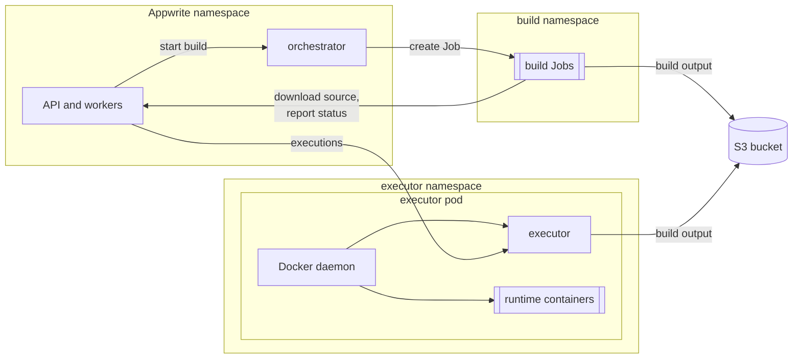

# Functions and Sites

Appwrite runs Functions and Sites with two
[Open Runtimes](https://github.com/open-runtimes) services:

| Service | Does | Where it runs | Appwrite setting |
| --- | --- | --- | --- |
| [orchestrator](https://github.com/open-runtimes/orchestrator) | Builds deployments | In the release namespace; it starts each build as a Kubernetes Job in the build namespace | `_APP_JOBS_HOST`, `_APP_JOBS_SECRET` |
| [executor](https://github.com/open-runtimes/executor) | Starts runtime containers and executes functions and sites in them | In the executor namespace, on Docker-in-Docker | `_APP_EXECUTOR_HOST`, `_APP_EXECUTOR_SECRET` |

The chart runs both and wires Appwrite to them. Builds run as ordinary,
unprivileged Jobs. The executor creates a container per runtime through a
Docker daemon, and Kubernetes has no Docker daemon to offer, so the chart
gives each executor pod its own (Docker-in-Docker). That daemon runs as a
**privileged container: root on its node**. That is why the executor gets a
namespace of its own, and why it should get nodes of its own. Where
privileged pods aren't allowed (GKE Autopilot, EKS on Fargate, a policy that
forbids them), [Sysbox](#without-a-privileged-container) runs the daemon
without it, or set `compute.enabled: false`.



Functions and Sites are on by default, on the
[built-in object storage](storage.md#built-in-object-storage). With
`compute.enabled: false`, the rest of Appwrite works, but creating a function
or site fails
([troubleshooting.md](troubleshooting.md#deployments-fail-with-an-internal-error)).

## Requirements

- **S3 storage** (`storage.device: s3`, the default, see
  [storage.md](storage.md)): the built-in object storage or your own store.
  Builds and the executor exchange code and build output through the bucket.
  The chart refuses to render `compute.enabled` without it.
- **Nodes that may run a privileged pod** for the executor, ideally
  dedicated to it, or [Sysbox](#without-a-privileged-container). The
  executor's namespace must admit the `privileged` Pod Security Standard. On
  OpenShift, Security Context Constraints apply too: the executor's
  ServiceAccount (`<fullname>-executor`) needs one that allows privileged
  containers. The chart's CI doesn't test OpenShift.
- **Room for builds and executions.** Each build runs as a pod in the build
  namespace ([build resources](#build-resources)); executions run inside the
  executor pod ([sizing](#sizing)).
- **Access to Docker Hub**, or a mirror of it: runtime images are always
  pulled by their Docker Hub names ([registries](#registries)).
- **A CNI that enforces NetworkPolicies**, for the
  [executor](#executor-isolation) and [build](#isolation) isolation to take
  effect. Without one, the policies are created but do nothing.

## 1. Configure the chart

A plain install already runs both, with the built-in object storage and the
executor on any node. For production, pin the executor to nodes of its own,
use an S3 store with redundancy, and pick the runtimes you need:

```yaml
appwrite:
  domain: appwrite.example.com

storage:
  device: s3
  s3:
    mode: external
    external:
      endpoint: https://s3.example.com   # empty for AWS S3
      region: us-east-1
    bucket: appwrite
    accessKeyId:
      value: <access key>
    secretAccessKey:
      value: <secret key>

compute:
  executor:
    privileged: true            # the default; Docker-in-Docker: root on the node
    nodeSelector:
      workload: executor
    tolerations:
      - key: workload
        value: executor
        effect: NoSchedule
  functionsRuntimes: [node-22, python-3.12, php-8.3]
  sitesRuntimes: [static-1, node-22]
```

[examples/functions.yaml](../examples/functions.yaml) holds the same values,
plus the wildcard Ingress that preview URLs need ([domains](#domains)).
Install it on top of your other values:

```console
helm upgrade --install appwrite oci://ghcr.io/appwrite/charts/appwrite \
  --namespace appwrite --create-namespace \
  -f minimal.yaml -f functions.yaml --wait --timeout 15m
```

When your S3 keys or the chart's credentials come from Secrets you manage, as
in `production.yaml`, use
[examples/functions-existing-secrets.yaml](../examples/functions-existing-secrets.yaml)
instead ([existing Secrets](#existing-secrets)).

| Value | Default | What it does |
| --- | --- | --- |
| `compute.enabled` | `false` | Deploys the orchestrator and the executor and turns on Functions and Sites. |
| `compute.executor.privileged` | `false` | Accepts the privileged Docker daemon. Required unless `compute.executor.runtimeClassName` is set. |
| `compute.functionsRuntimes` | `[]` | Function runtimes (`_APP_FUNCTIONS_RUNTIMES`). Empty keeps the Docker installer's list (`node-16.0`, `node-22`, `php-8.0`, `python-3.9`, `ruby-3.0`). |
| `compute.sitesRuntimes` | `[]` | Site runtimes (`_APP_SITES_RUNTIMES`). Empty keeps Appwrite's default list. |
| `compute.executor.nodeSelector`, `tolerations` | inherit `defaults` | Where executor pods run. |

The executor pulls an image for every runtime in both lists when it starts
([the executor](#the-executor)), so list only the runtimes you use. Keep
`node-22` in `sitesRuntimes` even if you only host static sites: sites are
built with a Node.js runtime, and without it creating a site fails with
`Runtime "node-22" is not supported`.

This deploys:

- the orchestrator in the release namespace, and a namespace for builds,
  `<release namespace>-builds` (`compute.builds.namespace`);
- the executor in a namespace of its own, `<release namespace>-executor`
  (`compute.executor.namespace`), with a Service Appwrite calls at
  `http://<fullname>-executor.<namespace>.svc:9900/v1`.

Both namespaces must differ from the release namespace and from each other;
the chart refuses to render otherwise. The chart generates the executor and
orchestrator secrets and keeps them in its Secret.

### Who creates the namespaces

With `compute.builds.createNamespace` and `compute.executor.createNamespace`
(both true by default) the chart creates the Namespaces, labelled for the
`baseline` and the `privileged` Pod Security Standard. That has
consequences:

- A Namespace is cluster-scoped, so whoever runs Helm (or the GitOps tool)
  needs permission to create Namespaces, and an Argo CD AppProject has to
  allow the `Namespace` kind ([gitops.md](gitops.md#argo-cd)).
- `helm uninstall` deletes the Namespaces, and with them any build Jobs
  and executor pods still in them.

To manage them yourself, create and label them before installing, and set
`createNamespace: false`:

```console
kubectl create namespace appwrite-builds
kubectl label namespace appwrite-builds \
  pod-security.kubernetes.io/enforce=baseline \
  pod-security.kubernetes.io/warn=baseline
kubectl create namespace appwrite-executor
kubectl label namespace appwrite-executor \
  pod-security.kubernetes.io/enforce=privileged
```

```yaml
compute:
  builds:
    createNamespace: false
    namespace: appwrite-builds
  executor:
    createNamespace: false
    namespace: appwrite-executor
```

The build namespace's `enforce` label matters
([security.md](security.md#functions-and-sites)). When the chart can read the
namespace and it doesn't enforce `baseline` or `restricted`, it prints a
warning after install or upgrade.

## 2. Check it

Wait for the orchestrator and the executor to become ready. The executor
pulls every runtime image before it reports ready, which can take several
minutes on a first start:

```console
kubectl -n appwrite rollout status deploy/appwrite-orchestrator
kubectl -n appwrite-executor rollout status deploy/appwrite-executor --timeout 15m
```

In the console, create a function from a template (Functions → Create
function), wait for its deployment to become ready, and execute it. Then
create a site from a template. Each build shows up as a Job, and each runtime
as a container in the executor's Docker daemon:

```console
kubectl -n appwrite-builds get jobs
kubectl -n appwrite-executor exec deploy/appwrite-executor -c dind -- docker ps
```

From a clone of this repository, a script does the same for a function. It
needs `kubectl`, `curl`, `jq` and `tar`, and reaches the API through a
port-forward:

```console
SMOKE_EMAIL=<admin email> SMOKE_PASSWORD=<password> \
  hack/functions-smoke.sh appwrite appwrite node-22
```

It creates a project named `functions` with a Node.js function, uploads code,
waits for the build and executes it. Delete the project afterwards. Without
`SMOKE_EMAIL` and `SMOKE_PASSWORD` it signs in as `smoke@example.com`, and on
an install where nobody has signed up yet, that account becomes the console
administrator.

## The executor

Each executor pod runs two containers:

- `dind`, the Docker daemon, a [native sidecar](https://kubernetes.io/docs/concepts/workloads/pods/sidecar-containers/)
  that starts first and stops last. It listens only on a Unix socket shared
  with the other container; there's no TCP listener.
- `executor`, which starts the executor as a container *of that daemon*: the
  executor looks itself up as a container, attaches itself to the network it
  creates for runtimes and reaches them by name, so it can't run beside the
  daemon. The container's logs are the executor's.

The executor's image and the runtime images are pulled by that daemon, not
by the kubelet, so image pull secrets don't apply to them
([registries](#registries)). The daemon's storage is an `emptyDir` of at most
20Gi (`compute.executor.dind.volume` takes any volume source), so a new pod
starts with no images. On start the executor pulls the runtime images of
`functionsRuntimes` and `sitesRuntimes` (`compute.executor.images` overrides
the list), and the pod only becomes ready once they're there: an execution
that had to wait for an image would run into the function's timeout. The
startup probe gives this 15 minutes.

The daemon's networks (its bridge and the runtimes' network) take their
addresses from `compute.executor.dind.addressPool`, `198.18.0.0/15` by
default, a range reserved for benchmarking that nothing routes. Whatever
those networks use, the executor and the runtimes can't reach elsewhere: a
pool that overlaps the S3 endpoint, the cluster or your network cuts them
off from it. Docker's own default, `172.17.0.0/16` and up, overlaps often
(the AWS default VPC is `172.31.0.0/16`), so change the pool only to another
range nothing in your network uses.

On updates a new pod takes over before the old one stops. The old one leaves
the Service, gives executions in flight 15 seconds to finish, and stops; its
runtimes stop with it.

### Executor isolation

A privileged container can do anything on its node, and the executor runs
code your users deploy. The chart keeps it apart from the rest of the
installation:

- **Own namespace**, the only one that admits privileged pods. The Appwrite
  namespace keeps `restricted`, the build namespace `baseline`.
- **No Kubernetes API access.** The executor's ServiceAccount has no token.
- **Own copy of its credentials.** Pods can't read Secrets in other
  namespaces, so the chart puts the executor secret and the S3 credentials in
  a Secret in the executor namespace, and nothing else.
- **NetworkPolicy** (`compute.executor.networkPolicy.enabled`, on by
  default, independent of `networkPolicy.enabled`): only Appwrite pods of the
  release can connect, on port 9900. The executor and every runtime can reach
  only DNS, the S3 endpoint and public addresses, with the same blocked ranges
  as builds ([below](#isolation)), plus
  `compute.executor.networkPolicy.deniedCIDRs`. Runtimes reach Appwrite
  through its public domain, like any other client.

What it can't do is stop a runtime that escapes its container: that runtime
is root on the node. Give the executor **nodes of its own**, with a taint
nothing else tolerates, so the only things on those nodes are executor pods:

```yaml
compute:
  executor:
    nodeSelector:
      workload: executor
    tolerations:
      - key: workload
        value: executor
        effect: NoSchedule
```

Don't put the API, the datastores or anything holding credentials there. If
that's more than you can accept, use Sysbox.

### Without a privileged container

[Sysbox](https://github.com/nestybox/sysbox) is a container runtime that
runs Docker inside a container without `privileged`, using user namespaces.
Install it on the executor's nodes (it provides a `sysbox-runc`
RuntimeClass), then:

```yaml
compute:
  executor:
    privileged: false
    runtimeClassName: sysbox-runc
```

Sysbox supports a limited set of distributions and container runtimes; check
its documentation for your nodes. The chart's CI doesn't test it.

### Sizing

Runtimes run inside the `dind` container, so its resources
(`compute.executor.resources`, 500m CPU and 1Gi requested, 4Gi memory limit
by default) are what all runtimes on that pod share. The executor starts each
runtime with the CPU and memory of the function's or site's runtime
specification, set per function or site. Without a cap, Appwrite offers
specifications up to 8 CPUs and 8 GB, and the API defaults new functions and
sites to the largest. Cap them with `_APP_COMPUTE_CPUS` and
`_APP_COMPUTE_MEMORY` (in MB), so no single runtime can claim the whole pod:

```yaml
appwrite:
  config:
    _APP_COMPUTE_CPUS: 2
    _APP_COMPUTE_MEMORY: 2048
```

Set them before users create functions and sites: existing ones keep the
specification they have. Then size the `dind` limits for the runtimes you
expect at once.

Runtimes stay warm after use. The executor checks for idle runtimes once an
hour and removes those idle for longer than
`compute.executor.inactiveThreshold` seconds (60 by default), so an idle
runtime holds its memory for up to an hour.

`compute.executor.replicaCount` (1 by default) adds executor pods, each with
its own daemon, spread across nodes where possible. Appwrite calls the
Service, so an execution lands on any of them; when a runtime isn't running
on that pod yet, the executor starts it there (a cold start). More replicas
spread executions, at the cost of more cold starts and more copies of each
warm runtime.

**Node drains.** The chart creates no PodDisruptionBudget for the executor,
and a replacement pod has to pull the executor and every runtime image before
it's ready. With one replica, draining its node stops executions until then.
Run at least two replicas, on different executor nodes, and add a budget so a
drain takes one at a time:

```console
kubectl -n appwrite-executor create poddisruptionbudget appwrite-executor \
  --selector app.kubernetes.io/instance=appwrite,app.kubernetes.io/component=executor \
  --max-unavailable 1
```

Runtimes on an evicted pod stop with it, and their next executions are cold
starts on another pod. A [registry mirror](#registries) near the cluster
shortens the image pulls.

### Existing Secrets

When the executor secret (`compute.secrets.existingSecret`) or the S3
credentials (a `secretName` in `storage.s3.accessKeyId` or
`storage.s3.secretAccessKey`) come from Secrets you manage, the chart can't
copy them, and refuses to render until you set
`compute.executor.existingSecret`. Create a Secret in the executor namespace
with the keys `executor-secret`, `s3-access-key` and `s3-secret-key`, and
name it there:

```console
kubectl -n appwrite-executor create secret generic appwrite-executor-credentials \
  --from-literal=executor-secret=<executor secret> \
  --from-literal=s3-access-key=<access key> \
  --from-literal=s3-secret-key=<secret key>
```

```yaml
compute:
  executor:
    existingSecret: appwrite-executor-credentials
```

`executor-secret` must match the executor secret Appwrite uses, or executions
fail with 401.
[examples/functions-existing-secrets.yaml](../examples/functions-existing-secrets.yaml)
has the full setup, with the commands to create both Secrets.

### Registries

Not every image is pulled the same way:

| Image | Pulled by | From | Follows `global.imageRegistry` and `global.imagePullSecrets` |
| --- | --- | --- | --- |
| Orchestrator | kubelet | ghcr.io | Yes |
| Docker daemon (`compute.executor.dind.image`) | kubelet | docker.io | Yes. The pull secrets must exist in the executor namespace. |
| Executor (`compute.executor.image`) | the executor's Docker daemon | docker.io | Registry only: the daemon doesn't use pull secrets |
| Runtime images for executions (`openruntimes/node:v5-22`, ...) | the executor's Docker daemon | Docker Hub | No |
| Runtime images for builds | kubelet, in the build namespace | Docker Hub | No |
| Build sidecar (`compute.builds.sidecarImage`) | kubelet, in the build namespace | ghcr.io | Registry only: the build ServiceAccount has no pull secrets |

Appwrite names runtime images by their Docker Hub names, and neither
`global.imageRegistry` nor `compute.executor.images` changes the names it
asks for. What works today:

**Docker Hub rate limits.** Docker Hub limits anonymous pulls per IP address.
Let the executor pull as a Docker Hub user:

```yaml
compute:
  executor:
    extraEnv:
      - name: OPR_EXECUTOR_DOCKER_HUB_USERNAME
        value: <user>
      - name: OPR_EXECUTOR_DOCKER_HUB_PASSWORD
        valueFrom:
          secretKeyRef: {name: docker-hub, key: password}   # in the executor namespace
```

Build pods pull runtime images through the kubelet, so they count against
the node's address, not this account.

**A Docker Hub mirror.** Point the executor's daemon at a pull-through cache
of Docker Hub. A mirror on a private network needs an egress rule too:

```yaml
compute:
  executor:
    dind:
      extraArgs: [--registry-mirror=https://mirror.example.internal]
    networkPolicy:
      extraEgress:
        - to: [{ipBlock: {cidr: 10.0.0.40/32}}]
          ports: [{port: 443}]
```

Docker uses mirrors only for Docker Hub images, which covers the runtime
images and the executor image while `global.imageRegistry` is empty. For
builds, configure the same mirror for `docker.io` in each node's container
runtime (for containerd, its registry host configuration): the kubelet pulls
those images, so the build NetworkPolicy doesn't apply to the pull.

**Private registries and air-gapped clusters** are only partly supported:

- The executor's daemon logs in to Docker Hub only. With `global.imageRegistry`
  set, the executor image comes from your registry, which must let the
  executor pods pull it without credentials.
- The build ServiceAccount has no image pull secrets, and the chart has no
  setting for them. The sidecar, and the runtime images if your nodes mirror
  Docker Hub to your registry, must be pullable anonymously or with the
  nodes' own credentials.
- The executor runs `docker pull` for its own image every time it starts,
  and stops if that fails, even when the image is already on the daemon's
  volume. While the registry or mirror is down, executor pods can't start.

An air-gapped install therefore needs a Docker Hub mirror inside the network,
holding the executor and every runtime image, used by the executor's daemon
(`--registry-mirror`) and by the nodes, plus a copy of the ghcr.io images in a
registry the nodes can pull from.

## Builds

### Isolation

A build runs the install and build commands of a function or site, which can
be any code. The chart keeps builds apart from the rest of the installation:

- **Own namespace**, admitted under the `baseline` Pod Security Standard.
  Build images may run as root, so builds can't pass `restricted`; `baseline`
  still forbids privileged pods and access to the host. The Appwrite
  namespace keeps `restricted`.
- **No Kubernetes API access.** Build pods get a ServiceAccount without a
  token. Only the orchestrator has one, with a Role limited to Jobs and their
  pods in the build namespace.
- **NetworkPolicy** (`compute.builds.networkPolicy.enabled`, on by default,
  independent of `networkPolicy.enabled`): nothing can connect to build pods,
  and they can reach only DNS, the API and orchestrator of the release, the S3
  endpoint, and public addresses. Private, loopback, link-local (including
  cloud metadata at `169.254.169.254`), CGNAT, multicast and reserved ranges
  are blocked, as is Azure's WireServer (`168.63.129.16`), plus anything in
  `compute.builds.networkPolicy.deniedCIDRs`.

"Public addresses" means everything outside those ranges, which isn't always
outside your cluster. Add to `deniedCIDRs` (empty by default) when cluster
addresses aren't in the private ranges:

- pod and Service ranges outside RFC 1918, for example GKE's privately used
  public ranges or `240.0.0.0/4`,
- node addresses, if nodes have public IPs (NodePorts are reachable on them),
- IPv6 pod, Service and node ranges on IPv6 or dual-stack clusters; only
  unique-local and link-local IPv6 is blocked by default.

```yaml
compute:
  builds:
    networkPolicy:
      deniedCIDRs:
        - 34.118.224.0/20        # GKE Service range
        - 2600:1f14:abc::/56     # IPv6 pod range
```

The same applies to the executor: add the same ranges to
`compute.executor.networkPolicy.deniedCIDRs`.

The build's sidecar uploads the output straight to S3. The chart allows the
built-in object store, and an external `storage.s3.external.endpoint` that
is an IP address; when it's a hostname on a private network, add a rule (and the same rule under
`compute.executor.networkPolicy.extraEgress`, which reads build output from
S3):

```yaml
compute:
  builds:
    networkPolicy:
      extraEgress:
        - to:
            - namespaceSelector:
                matchLabels:
                  kubernetes.io/metadata.name: minio
          ports:
            - port: 9000
```

Add rules the same way for a private package registry.

> [!NOTE]
> The orchestrator passes its S3 credentials and the orchestrator secret to
> each build's sidecar as environment variables, and the secret also lands in
> the pod annotation `job.callback.key`, so both are readable from the Job and
> pod objects in the build namespace. The build's own container doesn't get
> them. Anyone with `view` on the build namespace can read them: limit access
> as you would to the chart's Secret, and give Appwrite S3 credentials that
> only reach its bucket ([security.md](security.md#functions-and-sites)).

### Build resources

A build's limits are the CPU and memory of the function's or site's build
specification. Without the caps from [sizing](#sizing), the API defaults new
functions to 8 CPUs and 8 GB and new sites to 2 CPUs and 2 GB. Appwrite raises
build memory to at least 1 GB for functions and 2 GB for sites (4 GB for
Analog and TanStack Start), whatever the specification.

On Kubernetes the request is what the scheduler reserves, so the orchestrator
divides the limits by `compute.builds.cpuOvercommit` and
`compute.builds.memoryOvercommit` (8 by default) to get the requests:

| Build | Limits | Requests with the defaults |
| --- | --- | --- |
| Function, default specification | 8 CPUs, 8192 MB | 1 CPU, 1024 MB |
| Site, default specification | 2 CPUs, 2048 MB | 0.25 CPU, 256 MB |

With the default `memoryOvercommit`, a build may use 8 times the memory the
scheduler reserved for it, and the chart puts no ResourceQuota or LimitRange
on the build namespace. A few large builds on one node can run it out of
memory, and then other pods on that node can be evicted or killed too, not
only builds. To keep builds from affecting anything else:

- give builds nodes of their own, so they only compete with each other:

  ```yaml
  compute:
    builds:
      nodeSelector:
        workload: builds
      tolerations:
        - key: workload
          value: builds
          effect: NoSchedule
  ```

- lower `memoryOvercommit` (1 reserves the whole limit), and raise it only
  as far as your nodes have room for;
- cap the specifications with `_APP_COMPUTE_MEMORY` and `_APP_COMPUTE_CPUS`
  ([sizing](#sizing)).

Lower divisors also give faster, more predictable builds; higher ones let
builds schedule on small clusters. Finished build Jobs are removed after
`compute.builds.retention` (15 minutes).

## Cluster DNS

The executor's and the build namespace's NetworkPolicies allow DNS only on
port 53, to the peers in `networkPolicy.egress.dns` (by default pods
labelled `k8s-app: kube-dns`). They're on by default, so this applies even
when `networkPolicy.enabled` is false. Clusters that serve DNS elsewhere need
a rule for each ([networking.md](networking.md#networkpolicies-and-dns)):

- **OpenShift** DNS pods listen on 5353:

  ```yaml
  compute:
    executor:
      networkPolicy:
        extraEgress: &dns
          - to:
              - namespaceSelector:
                  matchLabels:
                    kubernetes.io/metadata.name: openshift-dns
            ports:
              - {port: 5353, protocol: UDP}
              - {port: 5353, protocol: TCP}
    builds:
      networkPolicy:
        extraEgress: *dns
  ```

- **NodeLocal DNSCache** answers on a link-local address (usually
  `169.254.20.10`), which the policies block. It still uses port 53, so add
  the address to `networkPolicy.egress.dns` instead; that one change reaches
  the executor's and the builds' policies as well as the release's:

  ```yaml
  networkPolicy:
    egress:
      dns:
        - namespaceSelector: {}
          podSelector:
            matchLabels:
              k8s-app: kube-dns
        - ipBlock:
            cidr: 169.254.20.10/32
  ```

Helm replaces lists rather than merging them, so when you layer values files,
keep all of a policy's `extraEgress` rules in one of them.

## With restricted egress

`networkPolicy.egress.enabled` (with `networkPolicy.enabled`) limits every
pod of the release to DNS, the release itself and the executor, which cuts
off the rest of the compute plane. Add rules to
`networkPolicy.egress.extraRules` for:

- **the S3 endpoint**, which the API, workers and orchestrator use,
- **the Kubernetes API server**, which the orchestrator calls. Its address is
  in the `kubernetes` Service's EndpointSlice
  (`kubectl get endpointslice -l kubernetes.io/service-name=kubernetes`).

```yaml
networkPolicy:
  enabled: true
  egress:
    enabled: true
    extraRules:
      - to: [{ipBlock: {cidr: 10.0.0.30/32}}]      # S3
        ports: [{port: 443}]
      - to: [{ipBlock: {cidr: 172.18.0.2/32}}]     # Kubernetes API server
        ports: [{port: 6443}]
```

The chart prints a warning after install or upgrade while compute is on,
egress is restricted and `extraRules` is empty.

## Domains

Functions and sites are reached on their own hostnames, which go to the API
through the wildcard and custom-domain routes
([networking.md](networking.md#routes)). Preview hostnames need the wildcard
Ingress (`ingress.wildcard.enabled`) or Gateway listeners, and a wildcard
certificate, which takes a DNS-01 issuer
([networking.md](networking.md#cert-manager)).

- **Sites** get a preview domain under `*.<appwrite.sitesDomain>` for each
  deployment (`sites.<domain>` by default). Previews ask for a console login,
  so only project members see them. Add a domain to the site (Sites → Domains)
  to publish it.
- **Functions** deployed from your own code get no domain automatically; add
  one under `*.<appwrite.functionsDomain>` (`functions.<domain>` by default)
  or a custom domain (Functions → Domains). Functions created from a template
  get one.

## Troubleshooting

| Symptom | Likely cause |
| --- | --- |
| Deployments stay `waiting` | The orchestrator isn't running, or can't reach the Kubernetes API (restricted egress, [above](#with-restricted-egress)): check `kubectl -n appwrite logs deploy/appwrite-orchestrator`. |
| Build pods stay `Pending` | No node has room for the build's request. Raise `compute.builds.cpuOvercommit` and `memoryOvercommit`, cap the specifications ([sizing](#sizing)), or add nodes. |
| Build pods are `OOMKilled`, or other pods on build nodes are killed or evicted | Builds use far more memory than they request ([build resources](#build-resources)): lower `memoryOvercommit` or give builds nodes of their own. |
| Build pods fail with `ErrImagePull` | The kubelet can't pull the runtime image from Docker Hub or the sidecar from its registry. Build pods get no pull secrets ([registries](#registries)). |
| Builds fail uploading the output (`dial tcp ... i/o timeout` in the build's `sidecar` container) | Build pods can't reach S3: add it to `compute.builds.networkPolicy.extraEgress`. |
| Builds fail installing dependencies | Build pods can't reach the package registry, for example a private one: add it to `extraEgress`. Or they can't resolve names ([cluster DNS](#cluster-dns)). |
| The executor pod isn't created: `violates PodSecurity "baseline"` (or `restricted`) | The executor namespace doesn't admit privileged pods. Label it `pod-security.kubernetes.io/enforce=privileged`, or let the chart create it. |
| The executor pod isn't ready, or restarts | Check `kubectl -n appwrite-executor logs deploy/appwrite-executor -c executor` and `-c dind`. The daemon pulls the executor image when the pod starts, and the pod is ready only once every runtime image is pulled: a blocked or rate-limited registry stops it ([registries](#registries)). A wrong `OPR_EXECUTOR_DOCKER_HUB_PASSWORD` fails the `docker login` before the executor starts. |
| Executions fail after a node drain or an executor update, then recover | The replacement pod was still pulling images. See [node drains](#sizing). |
| Executions fail with "Timed out waiting for runtime" | The executor can't find the build output: S3 is unreachable from the executor namespace (a private hostname needs `compute.executor.networkPolicy.extraEgress`), or S3 is in `compute.executor.dind.addressPool` ([above](#the-executor)). Or the runtime image can't be pulled. |
| Functions can't call Appwrite (`fetch failed`, connection timeouts to `appwrite.domain`) | Runtimes call Appwrite at `https://<appwrite.domain>/v1`. When that name resolves to a private address (an internal load balancer, a LAN), the executor's NetworkPolicy blocks it like any private range: allow your ingress controller or load balancer in `compute.executor.networkPolicy.extraEgress`. |
| Functions can't resolve any hostname | The executor can't reach the cluster DNS ([cluster DNS](#cluster-dns)). |
| Executions fail with 401 | `compute.executor.existingSecret` holds a different `executor-secret` than Appwrite's. |
| Creating a site fails with `Runtime "node-22" is not supported` | Add `node-22` to `compute.sitesRuntimes`. |
| A site's preview URL redirects to `/auth/preview` | Expected: previews need a console login. Add a domain to publish the site. |

Runtimes:
`kubectl -n appwrite-executor exec deploy/appwrite-executor -c dind -- docker ps`
lists them, and `docker logs <runtime>` (run the same way) shows a runtime's
output.

Build logs: `kubectl -n appwrite-builds logs job/<job> -c worker` (the build
itself) and `-c sidecar` (uploads). The orchestrator names these containers;
if they differ in your version, list them with
`kubectl -n appwrite-builds get pod <pod> -o jsonpath='{.spec.containers[*].name}'`.
